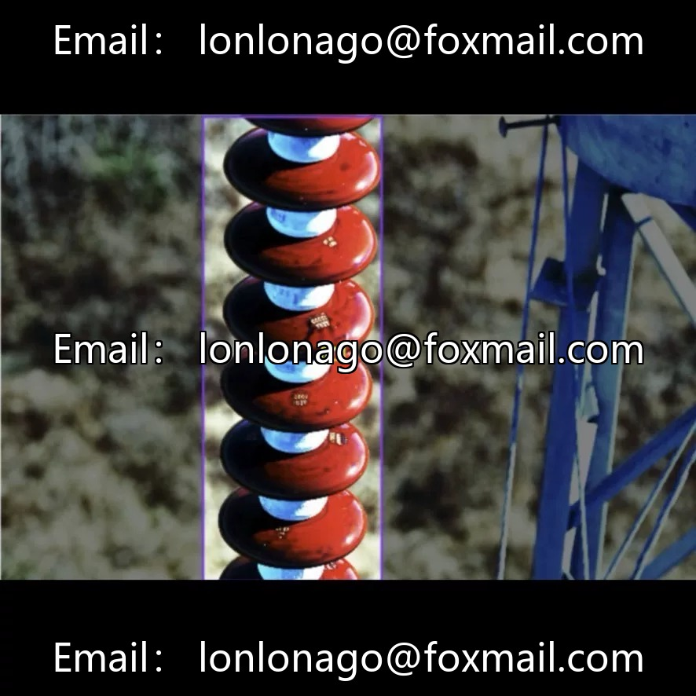
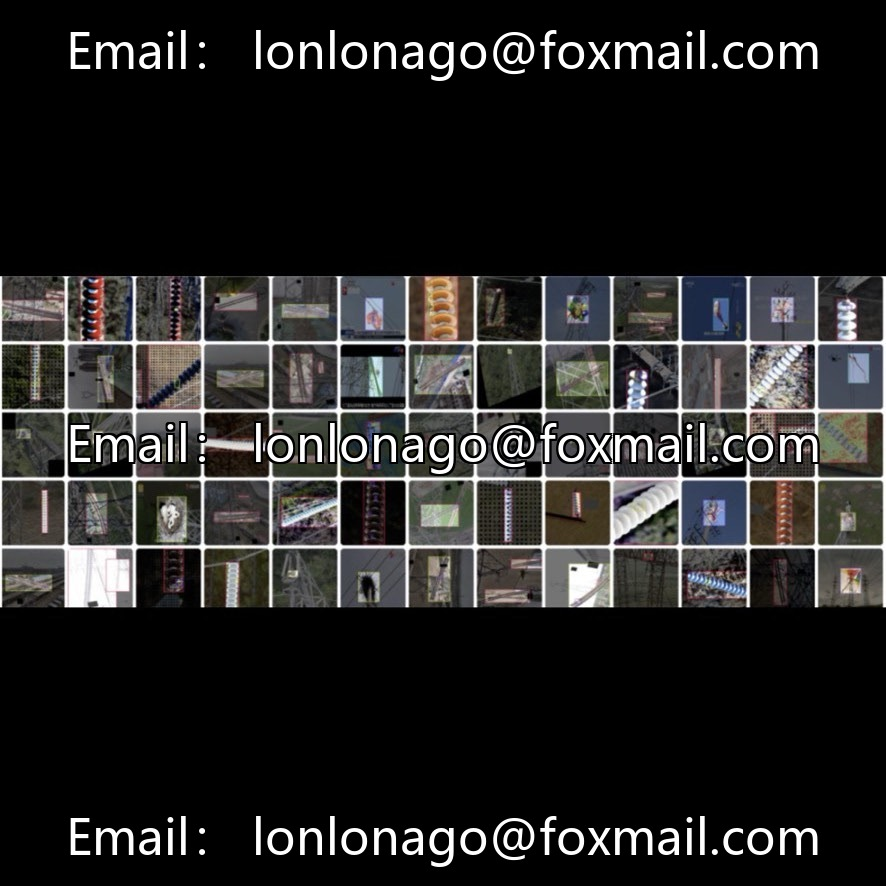
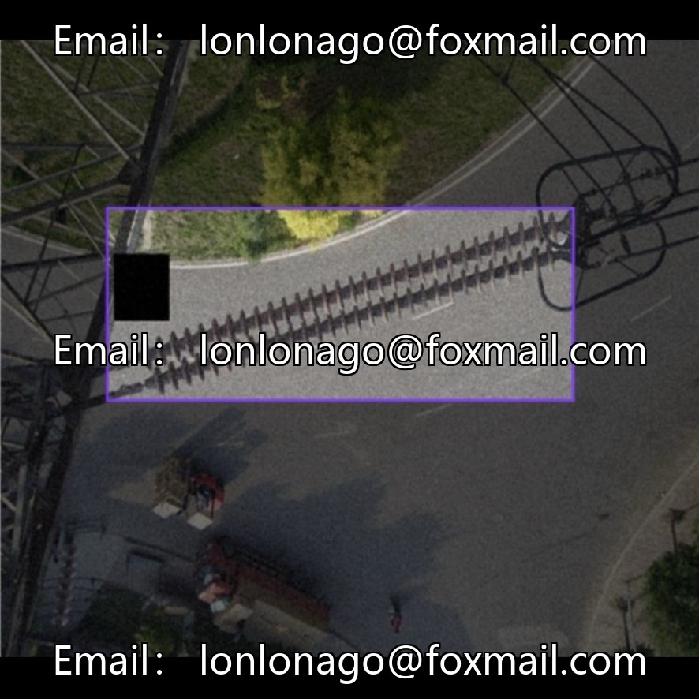
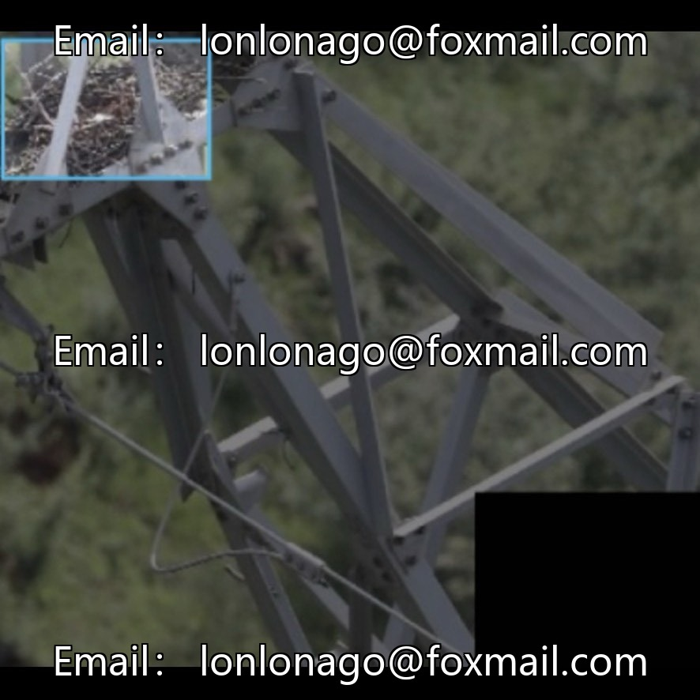
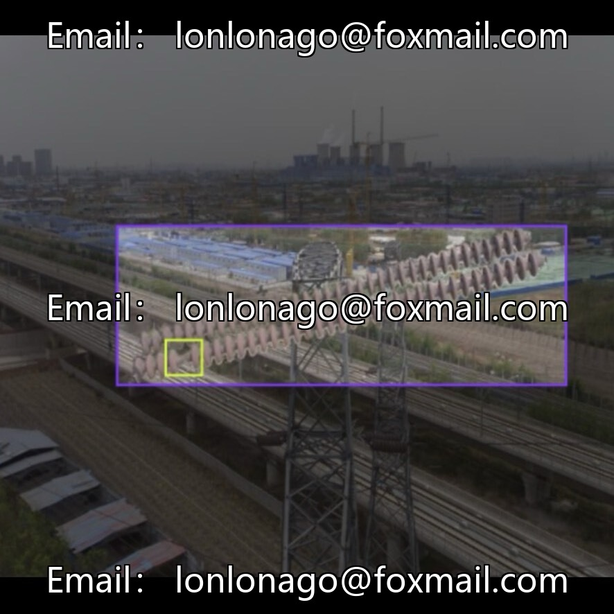

# Power aerial photography defect detection dataset, 10000+ high-definition drone aerial images

## Body

Power aerial photography defect detection dataset, 10000+ high-definition drone aerial images, 33 subdatasets covering scenarios such as insulators, fractures, defects, foreign objects, and bird's nests. The labeled categories include: fractures, defects, foreign objects, insulators, and bird's nests, totaling 5 categories. Complemented with 22 pre-trained models, it supports all series of YOLOv5/v7/v8/v10/v11, formatted as JPG/PNG images + YOLO TXT/VOC XML annotations. It is ready for model training, inference, and defect warning directly, suitable for the development of power intelligent inspection systems.

The dataset contains numerous small targets and complex backgrounds, suitable for optimization of small target defect detection. Application scenarios include power line inspection, insulator damage detection, bird nest recognition, foreign object invasion monitoring, and grid safety operation and maintenance.

Virtual materials, once sold, are non-refundable.
Interested friends, click "I want" to proceed.

## Images

## Payment

Here is a pay link on Stripe ( https://buy.stripe.com/3cs8yP7sY87d0vu9AB ). Please contact me lonlonago@foxmail.com after funding $89, and I will send you a complete data files , thank you!

